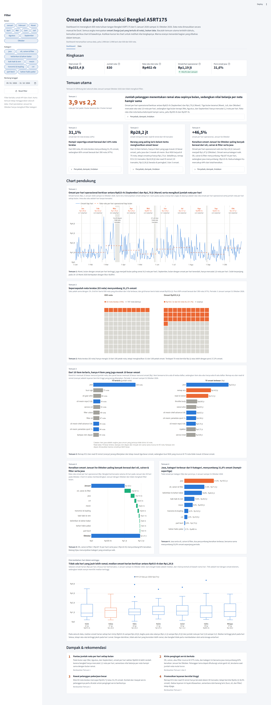

# Visualisasi Omzet dan Pola Transaksi Bengkel ASRT175 (Januari sampai Oktober 2026)

Dashboard interaktif ini dibuat untuk UAS Visualisasi Data, Prodi Teknologi Informasi, Fakultas Teknik ULM
Banjarbaru. Datanya berasal dari nota tulisan tangan sebuah bengkel motor yang dimasukkan secara manual ke Excel.

Semua angka di sini merupakan omzet (harga jual yang tertulis di nota), bukan laba.

## Problem

Pemilik bengkel kecil jarang mengetahui asal omzetnya dan penyebab omzet naik atau turun. Dashboard ini
menjawab enam pertanyaan:

1. Bagaimana tren omzet harian bengkel selama 5 Januari sampai 31 Oktober 2026?
2. Kategori barang dan jasa apa yang memberi kontribusi omzet terbesar?
3. Barang/jasa apa yang paling sering terjual, dan apakah sama dengan yang menghasilkan omzet terbesar?
4. Bagaimana pola omzet berdasarkan hari dalam seminggu?
5. Seberapa besar omzet bergantung pada sedikit transaksi bernilai besar?
6. Kategori apa yang paling berperan dalam perubahan omzet dari Januari ke Oktober 2026?

## Dataset

File: `data/DATASET_TRANSAKSI_BENGKEL_ASRT175.xlsx` (sheet `barangjasa` dan `kategori`). Kode hanya membaca
file ini, dan semua pengolahan dilakukan di dalam kode.

| Ringkasan | Nilai |
|---|---|
| Baris (item dalam nota) | 2.998 |
| Nota (transaksi) | 830 (no. 4001–4830) |
| Jenis barang/jasa | 249, dikelompokkan ke 9 kategori |
| Periode | 5 Januari sampai 31 Oktober 2026 (nota pertama tertanggal 5 Januari) |
| Hari bertransaksi | 280 dari 300 hari kalender |
| Total omzet | Rp333.386.000 |

Kolomnya adalah `no_nota`, `tanggal_transaksi`, `nama_barang`, `kategori`, `harga`, `qty`, dan `jumlah`
(= harga × qty). Sheet `kategori` berisi tabel lookup dari `nama_barang` ke `kategori`.

Persiapan data oleh penulis:

- Nota asli tidak memuat nomor nota sehingga penulis memberi nomor urut 4001–4830 sesuai urutan nota.
- Sebagian nota tidak mencantumkan qty, dan qty tersebut diisi penulis saat memasukkan data.
- Penulis menentukan kategori berdasarkan fungsi komponen melalui tabel lookup.
- Hasil input sudah dicocokkan ulang dengan nota fisik.

Saat dimuat, kode memastikan tidak ada nilai kosong, `jumlah = harga × qty`, tidak ada baris duplikat,
setiap nota hanya memiliki satu tanggal, kategori cocok dengan tabel lookup, dan semua tanggal berada di dalam
periode. Jika salah satu pemeriksaan gagal, dashboard berhenti dan menampilkan pesan error.

Jumlah hari bertransaksi setiap bulan berbeda (Jan 26, Feb 27, Mar 23, Apr 28, Mei 28, Jun 28, Jul 31, Agu 29,
Sep 30, Okt 30) sehingga perbandingan antarbulan memakai rata-rata omzet per hari operasional, yaitu omzet bulan
dibagi jumlah hari bertransaksi. Terdapat 20 hari tanpa transaksi, termasuk 18–25 Maret dan 27–29 Mei.

## Tools

- Python 3.12+ (numpy 2.5 membutuhkan Python 3.12 atau lebih baru), pandas untuk pengolahan, dan openpyxl
  untuk membaca Excel
- Plotly untuk chart, Streamlit untuk dashboard, dan kaleido untuk mengekspor PNG ke laporan, PPT, dan poster
- pytest untuk menguji angka, chart, dan kombinasi filter, serta Playwright untuk mengambil screenshot

## Dashboard



Link deploy: <https://dashboard-omzet-bengkel-asrt175.streamlit.app/>

Dashboard terdiri dari satu halaman:

1. Header serta filter bulan, kategori, rentang tanggal, dan tombol reset
2. Lima KPI: total omzet, jumlah nota, rata-rata nilai nota, omzet per hari operasional, dan porsi omzet jasa
3. Empat kartu temuan utama yang dihitung dari seluruh data. Kartu menampilkan temuan (WHAT), sedangkan
   expander "Penyebab, dampak, tindakan" berisi rincian angka, "Mengapa (kemungkinan)" (WHY), "Artinya"
   (SO WHAT), dan "Yang dapat dilakukan" (NOW WHAT)
4. Enam chart yang diurutkan mengikuti temuan: tren omzet harian (Temuan 1), waffle chart porsi nota dan porsi
   omzet (Temuan 2), barang terlaris dan omzet terbesar (Temuan 3), waterfall Januari ke Oktober serta omzet
   per kategori (Temuan 4), lalu box plot omzet harian per hari
5. Dampak dan rekomendasi
6. Tab Data yang berisi tabel terfilter, tombol unduh CSV, metodologi, dan keterbatasan data

PNG semua chart (data penuh) tersedia di [`assets/charts/`](assets/charts/).

## Key insights

Teks di bawah diambil dari kartu temuan di dashboard. Tindak lanjut setiap temuan dirangkum di bagian
Recommendation.

### 1. Jumlah pelanggan menentukan ramai atau sepinya bulan, sedangkan nilai belanja per nota hampir sama

Omzet per hari operasional berkisar antara Rp823 rb (September) dan Rp1,70 jt (Maret). Tiga bulan teramai
(Maret, Juli, dan Oktober) mencatat rata-rata 3,9 nota per hari, sedangkan tiga bulan tersepi (Mei, Agustus,
dan September) hanya mencatat 2,2 nota per hari. Rata-rata nilai nota kedua kelompok hampir sama, yaitu
Rp393 rb dan Rp397 rb. Korelasi antarbulan antara omzet per hari dan nota per hari sebesar 0,96, sedangkan
korelasinya dengan rata-rata nilai nota sebesar −0,15.

Mengapa (kemungkinan): Jumlah pelanggan kemungkinan mengikuti kalender hari raya dan libur. Bengkel tidak
mencatat transaksi pada 18–25 Maret, yang bertepatan dengan libur Idulfitri. Pada 1–17 Maret, jumlah nota
mencapai 4,35 per hari, atau lebih dari dua kali Februari (2,0). Banyak pelanggan diduga menyervis motor sebelum
mudik. Pada 1–15 Juli, jumlah nota mencapai 4,13 per hari, dan periode itu bertepatan dengan libur sekolah.
Rata-rata nilai nota stabil karena lebih dari separuh nota (57%) memuat oli, cairan, atau filter, yaitu barang
servis rutin yang harganya relatif tetap.

Artinya: Pada bulan sepi, omzet per hari sekitar Rp658 rb lebih rendah daripada bulan ramai (Rp889 rb
berbanding Rp1,55 jt).

### 2. Hampir sepertiga omzet berasal dari 10% nota teratas

Dari 830 nota, 83 nota teratas menyumbang 31,1% omzet, sedangkan 80% omzet berasal dari 390 nota (47%).
Terdapat 70 nota bernilai Rp1 jt atau lebih (8,4% dari semua nota) dengan porsi 27,3% omzet, dan 24 di
antaranya memuat item ECU atau remot.

Mengapa (kemungkinan): Pekerjaan bernilai besar, seperti pemrograman ECU dan remot, penggantian komponen
kelistrikan, atau perbaikan mesin, kemungkinan hanya dibutuhkan saat motor rusak atau dimodifikasi sehingga
tidak terjadwal seperti servis rutin. Komponen dari kategori kelistrikan & bahan bakar muncul di 41 dari 70 nota
bernilai Rp1 jt atau lebih.

Artinya: Jika sebagian pelanggan pekerjaan besar tidak kembali, omzet dapat turun banyak karena 83 nota tersebut
bernilai Rp103,7 jt.

### 3. Barang yang paling laris belum tentu menghasilkan omzet besar

Dari 10 item terlaris, hanya 4 item yang juga masuk 10 besar omzet, yaitu jasa dan 3 merek oli mesin. Busi NGK
terjual di 75 nota, tetapi omzetnya hanya Rp1,73 jt. Sebaliknya, remap ECU (21 transaksi, Rp14,93 jt) dan read
ID remot (19 transaksi, Rp13,30 jt) berada di peringkat 2 dan 3 omzet. Oli gear AHM juga muncul di 60 nota
dengan omzet Rp1,24 jt. Item jasa adalah ongkos jasa umum yang jenisnya tidak dirinci di nota. Pada batas
10 besar terlaris di chart V3, kampas rem depan dan minyak rem sama-sama muncul di 43 nota, dan kampas rem
depan dimasukkan karena omzetnya lebih besar.

Mengapa (kemungkinan): Barang laris seperti busi dan oli gear merupakan barang habis pakai murah yang diganti
secara berkala. Remap ECU dan read ID remot kemungkinan termasuk pekerjaan keahlian khusus yang jarang
dibutuhkan, tetapi bernilai tinggi. Rata-rata nilai remap ECU mencapai Rp711 rb dan read ID remot Rp700 rb per
transaksi, sedangkan busi NGK hanya Rp23 rb per nota.

Artinya: Omzet dari 40 transaksi remap ECU dan read ID remot sekitar 16 kali omzet busi NGK, item terlaris
kedua, dari 75 nota.

### 4. Kenaikan omzet Januari ke Oktober paling banyak berasal dari oli, cairan & filter serta jasa

Omzet per hari operasional naik dari Rp1,00 jt (Januari) menjadi Rp1,47 jt (Oktober), atau +46,5%. Omzet semua
kategori naik. Oli, cairan & filter menyumbang +Rp187 rb per hari, sedangkan jasa menyumbang +Rp110 rb. Kedua
kategori itu mencakup 64% dari total kenaikan. Jumlah nota per hari naik dari 2,7 menjadi 3,6, sedangkan
rata-rata nilai nota hanya naik dari Rp377 rb menjadi Rp404 rb.

Mengapa (kemungkinan): Jumlah pelanggan servis rutin kemungkinan bertambah. Penggantian oli biasanya disertai
ongkos jasa sehingga kedua kategori ini naik bersama. Selain itu, omzet per hari Januari termasuk rendah
(terendah ke-4 dari 10 bulan). Oleh karena itu, sebagian kenaikan mencerminkan naik-turunnya jumlah pelanggan
seperti pada Temuan 1 dan belum tentu menjadi tren yang berlanjut.

Artinya: Jika pelanggan servis rutin tidak kembali, kenaikan ini dapat hilang.

### Pola tambahan: hari dalam seminggu

Pada seluruh data, median omzet harian setiap hari mirip (Rp915 rb sampai Rp1,20 jt), begitu pula rata-ratanya
(Rp1,11 jt sampai Rp1,25 jt) dan jumlah nota per hari (2,8 sampai 3,2). Median tertinggi jatuh pada hari
Selasa, tetapi rata-rata tertinggi jatuh pada hari Jumat. Dengan demikian, tidak ada hari yang konsisten lebih
ramai, dan bengkel tidak perlu membedakan stok serta tenaga antarhari.

## Recommendation

1. Pantau jumlah nota per hari setiap bulan. Pada bulan sepi (Mei, Agustus, dan September), omzet per hari
   sekitar Rp658 rb lebih rendah karena bengkel hanya mencatat 2,2 nota per hari, sementara nilai belanja per
   nota hampir sama dengan bulan ramai. Berdasarkan Temuan 1.
2. Kirim pengingat servis berkala. Oli, cairan, atau filter muncul di 57% nota, dan kategori ini bersama jasa
   menyumbang 64% kenaikan Januari ke Oktober. Pelanggan lama dapat dihubungi untuk ganti oli, terutama saat
   jumlah nota mulai turun. Berdasarkan Temuan 1 dan 4.
3. Rawat pelanggan pekerjaan besar. Nilai 83 nota teratas mencapai Rp103,7 jt atau 31,1% omzet. Kontak dan
   riwayat servis pelanggannya perlu dicatat untuk pengingat servis berikutnya. Berdasarkan Temuan 2.
4. Promosikan layanan bernilai tinggi. Remap ECU dan read ID remot hanya tercatat dalam 40 transaksi, tetapi
   bernilai Rp28,2 jt (8,5% omzet). Kedua layanan ini layak ditawarkan, sementara stok barang laris (busi, oli,
   dan filter) tetap dijaga. Berdasarkan Temuan 3.

## Menjalankan secara lokal

```bash
python -m venv .venv
```

```bash
.venv\Scripts\activate        # Windows  (macOS/Linux: source .venv/bin/activate)
```

```bash
pip install -r requirements.txt
```

```bash
streamlit run app.py
```

Untuk pengujian dan ekspor chart:

```bash
pip install -r requirements-dev.txt
```

```bash
pytest
```

```bash
python scripts/export_charts.py
```

`kaleido` 1.x membutuhkan Google Chrome atau Chromium untuk mengekspor PNG. Jika Chrome belum terpasang, jalankan
`kaleido_get_chrome` (terpasang bersama kaleido). Untuk mengambil screenshot otomatis, jalankan dashboard lalu
`python scripts/screenshot.py http://localhost:8501` (perlu `playwright install chromium`).

## Struktur repo

```
.
├── app.py                    # entry streamlit
├── src/
│   ├── data.py               # load, validasi, kolom turunan
│   ├── metrics.py            # kpi dan angka insight
│   ├── charts.py             # figure plotly v1-v6
│   └── style.py              # palet, format rupiah, template plotly
├── data/DATASET_TRANSAKSI_BENGKEL_ASRT175.xlsx
├── scripts/
│   ├── export_charts.py      # ekspor v1-v6 ke assets/charts/*.png
│   └── screenshot.py         # screenshot dashboard
├── assets/                   # screenshot dashboard, png chart, dan ikon tab
├── tests/
│   ├── test_metrics.py       # angka acuan
│   ├── test_charts.py        # isi waffle chart v5 dan garis v1
│   └── test_app.py           # kombinasi filter dashboard
├── requirements.txt          # dependensi dashboard
├── requirements-dev.txt      # tambahan pytest dan playwright
└── .streamlit/config.toml    # tema
```

## Penulis

Ahmad Ulyani (NIM 2410817210008)
Visualisasi Data (UAS), Teknologi Informasi, Fakultas Teknik, Universitas Lambung Mangkurat, Banjarbaru.
