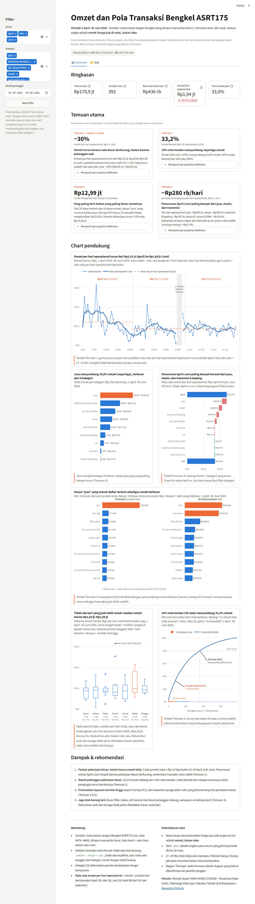

# Visualisasi Omzet dan Pola Transaksi Bengkel ASRT175 (1 April–30 Juni 2026)

Dashboard interaktif untuk UAS Visualisasi Data, Prodi Teknologi Informasi, Fakultas Teknik ULM Banjarbaru.
Data berasal dari nota tulisan tangan sebuah bengkel motor yang diinput manual ke Excel.

> Semua angka adalah **omzet** (harga jual yang tertulis di nota), **bukan laba**.

## Problem

Pemilik bengkel kecil jarang punya gambaran yang jelas tentang dari mana omzetnya berasal dan kenapa omzet
naik atau turun. Dashboard ini menjawab enam pertanyaan:

1. Bagaimana tren omzet harian bengkel selama 1 April–30 Juni 2026?
2. Kategori barang dan jasa apa yang memberi kontribusi omzet terbesar?
3. Barang/jasa apa yang paling sering terjual, dan apakah sama dengan yang menghasilkan omzet terbesar?
4. Bagaimana pola omzet berdasarkan hari dalam seminggu?
5. Seberapa besar omzet bergantung pada sedikit transaksi bernilai besar?
6. Kategori apa yang paling berperan dalam perubahan omzet dari April ke Juni 2026?

## Dataset

File: `data/DATASET_TRANSAKSI_BENGKEL_ASRT175.xlsx` (tidak diubah; semua transformasi dilakukan di kode).

| Ringkasan | Nilai |
|---|---|
| Baris (item dalam nota) | 1.442 |
| Nota (transaksi) | 392 (no. 4078–4469) |
| Jenis barang/jasa | 243, dikelompokkan ke 9 kategori |
| Hari bertransaksi | 88 dari 91 hari (April 30, Mei 28, Juni 30; tidak ada transaksi 27–29 Mei) |
| Total omzet | Rp170.854.500 |

Kolom: `no_nota`, `tanggal_transaksi`, `nama_barang`, `kategori`, `harga`, `qty`, `jumlah` (= harga × qty).
Sheet `kategori` berisi tabel lookup `nama_barang → kategori`.

Saat dimuat, data divalidasi otomatis (dashboard berhenti jika gagal): tidak ada nilai kosong,
`jumlah = harga × qty`, tidak ada baris duplikat, satu nota hanya punya satu tanggal, dan kategori cocok
dengan tabel lookup.

Karena jumlah hari bertransaksi tiap bulan berbeda, perbandingan antarbulan memakai
**rata-rata omzet per hari operasional** = omzet bulan ÷ jumlah hari bertransaksi.

## Tools

- **Python 3.11+**, **pandas** (pengolahan), **openpyxl** (baca Excel)
- **Plotly** (semua chart), **Streamlit** (dashboard), **kaleido** (ekspor PNG untuk laporan, PPT, dan poster)
- **pytest** dan **Playwright** (pengujian angka, kombinasi filter, dan screenshot)

## Dashboard



Link deploy: _(diisi setelah deploy ke Streamlit Community Cloud)_

Isi dashboard (satu halaman):

1. Header dan filter (bulan, kategori, rentang tanggal, tombol reset)
2. 5 KPI: total omzet, jumlah nota, rata-rata nilai nota, omzet per hari operasional, porsi omzet jasa
3. 4 kartu temuan utama (WHAT di depan; WHY / SO WHAT / NOW WHAT di expander), dihitung dari seluruh data
4. 6 chart: tren harian (line + rata-rata bergerak 7 hari), omzet per kategori (bar), terlaris vs omzet
   terbesar (dua bar), omzet harian per hari (box plot), Pareto nota, dan waterfall April→Juni
5. Dampak & rekomendasi, metodologi, dan keterbatasan data
6. Tab **Data**: tabel terfilter dan tombol unduh CSV

PNG semua chart (data penuh) ada di [`assets/charts/`](assets/charts/).

## Key Insights

1. **Omzet turun karena nota besar berkurang, bukan karena pelanggan sepi.** Rata-rata omzet per hari
   operasional turun ≈30% dari April (Rp2,41 jt) ke Juni (Rp1,69 jt), sementara nota per hari justru naik
   (4,5 → 4,8). Rata-rata nilai nota turun ≈35% (Rp539 rb → Rp353 rb). Nota ≥ Rp1 jt turun dari 21 nota
   (Rp30,9 jt) menjadi 8 nota (Rp9,8 jt), sedangkan omzet nota < Rp1 jt hampir sama (Rp41,3 jt vs Rp41,0 jt).
   _Dugaan: pekerjaan besar seperti remap ECU, turun mesin, dan perbaikan transmisi tidak datang rutin._
2. **10% nota teratas menyumbang sepertiga omzet.** 39 nota teratas menyumbang 33,2% omzet; 80% omzet
   berasal dari 180 nota (≈46%).
3. **Yang paling laris bukan yang paling besar omzetnya.** Hanya "jasa" yang masuk 10 besar terlaris sekaligus
   10 besar omzet. Remap ECU hanya 15 transaksi tetapi menghasilkan Rp12,99 jt, hampir setara jasa umum
   (159 nota, Rp14,28 jt). Busi NGK (27 nota) hanya Rp583 rb.
4. **Penurunan April→Juni paling banyak berasal dari jasa, mesin, dan transmisi.** Per hari operasional:
   jasa −Rp280 rb, mesin −Rp189 rb, transmisi & kopling −Rp142 rb, oli, cairan & filter −Rp104 rb.
   Kelistrikan & bahan bakar serta kaki-kaki & rem justru naik ≈Rp13 rb.

Pendukung (di caption chart): median omzet harian per hari hanya berkisar Rp1,63–1,95 jt (Sabtu sedikit
tertinggi). Rata-rata Kamis terdongkrak satu hari ekstrem (9 April, Rp6,29 jt), sehingga dipakai box plot.

Bagian "kenapa" adalah dugaan yang belum dikonfirmasi ke pemilik bengkel.

## Recommendation

1. Pantau jumlah pekerjaan besar (nota ≥ Rp1 jt) per bulan, bukan hanya omzet total.
2. Catat kontak dan riwayat servis pelanggan pekerjaan besar untuk pengingat servis berikutnya.
3. Promosikan layanan bernilai tinggi seperti remap ECU, dan tawarkan pengecekan rutin yang bisa berlanjut
   ke perbaikan besar.
4. Jaga stok barang laris (busi, filter udara, oli) karena membuat pelanggan datang. Kebutuhan stok dan
   tenaga tidak perlu dibedakan besar antarhari.

## Menjalankan secara lokal

```bash
python -m venv .venv
```

```bash
.venv\Scripts\activate        # Windows  (macOS/Linux: source .venv/bin/activate)
```

```bash
pip install -r requirements.txt
```

```bash
streamlit run app.py
```

Pengujian dan ekspor chart:

```bash
pip install -r requirements-dev.txt
```

```bash
pytest
```

```bash
python scripts/export_charts.py
```

`kaleido` 1.x membutuhkan Google Chrome/Chromium untuk mengekspor PNG. Jika Chrome belum ada, jalankan
`kaleido_get_chrome` (terpasang bersama kaleido). Untuk screenshot otomatis, jalankan dashboard lalu
`python scripts/screenshot.py http://localhost:8501` (perlu `playwright install chromium`).

## Struktur repo

```
.
├── app.py                    # entry Streamlit
├── src/
│   ├── data.py               # load + validasi + kolom turunan
│   ├── metrics.py            # semua KPI & angka insight (fungsi murni)
│   ├── charts.py             # figure Plotly V1–V6
│   └── style.py              # palet, format Rupiah, template Plotly
├── data/DATASET_TRANSAKSI_BENGKEL_ASRT175.xlsx
├── scripts/
│   ├── export_charts.py      # ekspor V1–V6 ke assets/charts/*.png
│   └── screenshot.py         # screenshot dashboard (Playwright)
├── assets/                   # screenshot dashboard & PNG chart
├── tests/
│   ├── test_metrics.py       # angka acuan
│   └── test_app.py           # kombinasi filter dashboard
├── requirements.txt          # dependensi dashboard (dipin)
├── requirements-dev.txt      # + pytest, playwright
└── .streamlit/config.toml    # tema
```

## Penulis

**Ahmad Ulyani** (NIM 2410817210008)
Visualisasi Data (UAS), Teknologi Informasi, Fakultas Teknik, Universitas Lambung Mangkurat, Banjarbaru.
